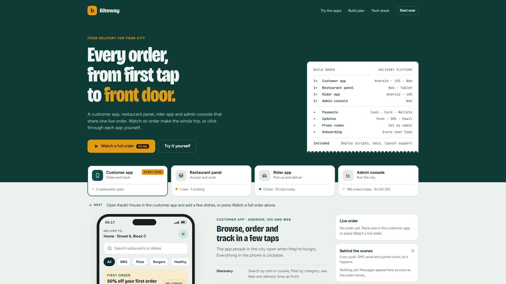
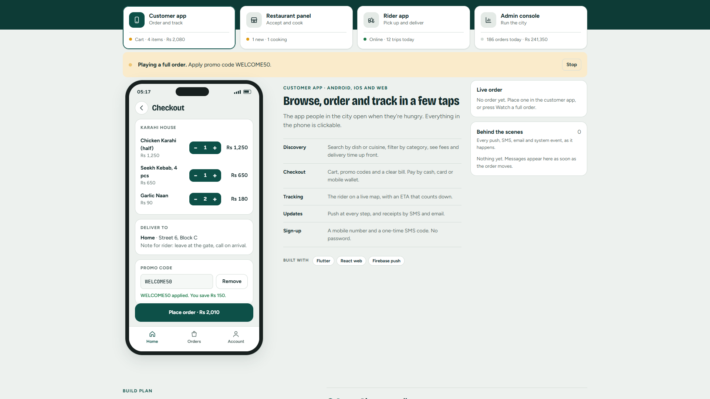
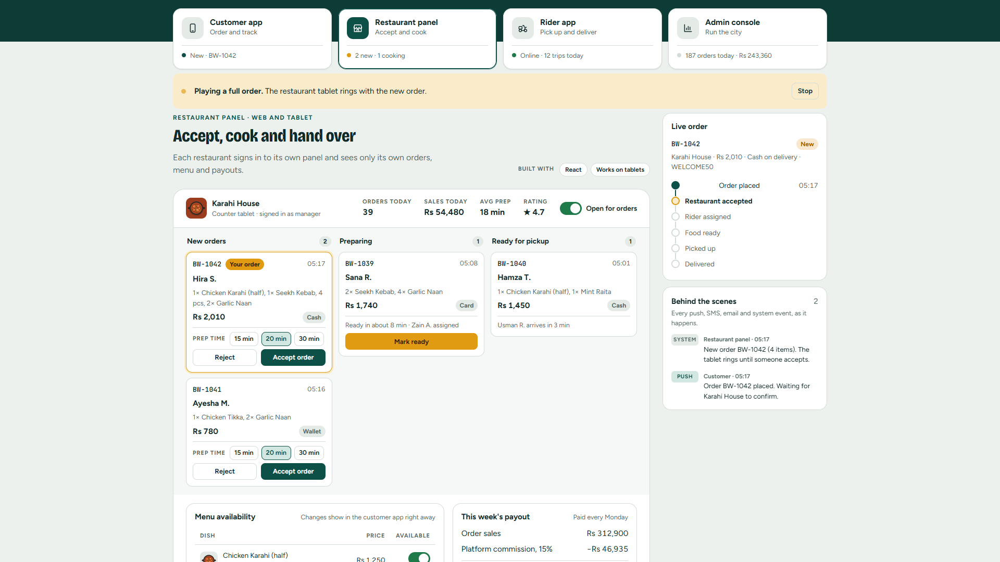
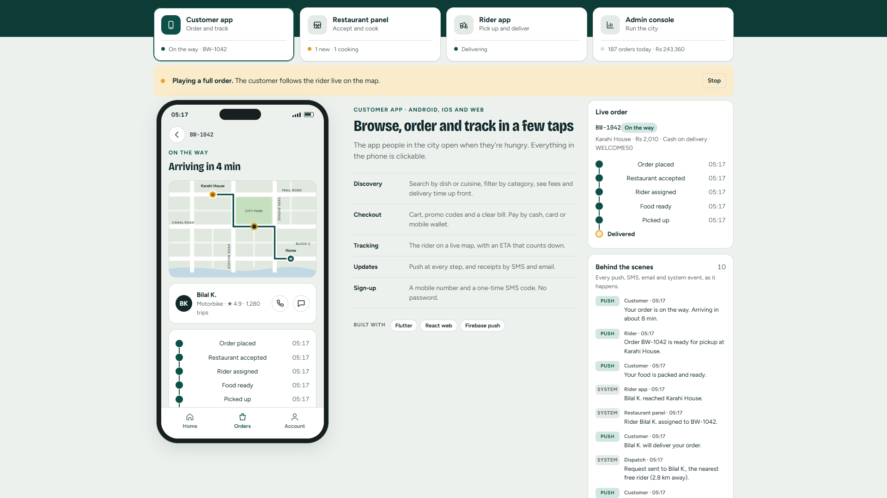
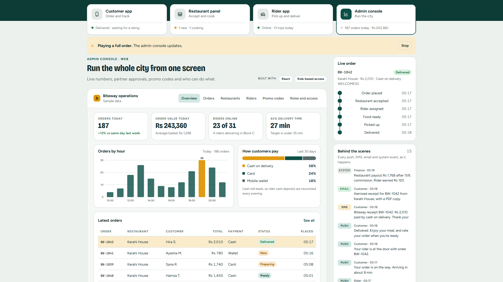
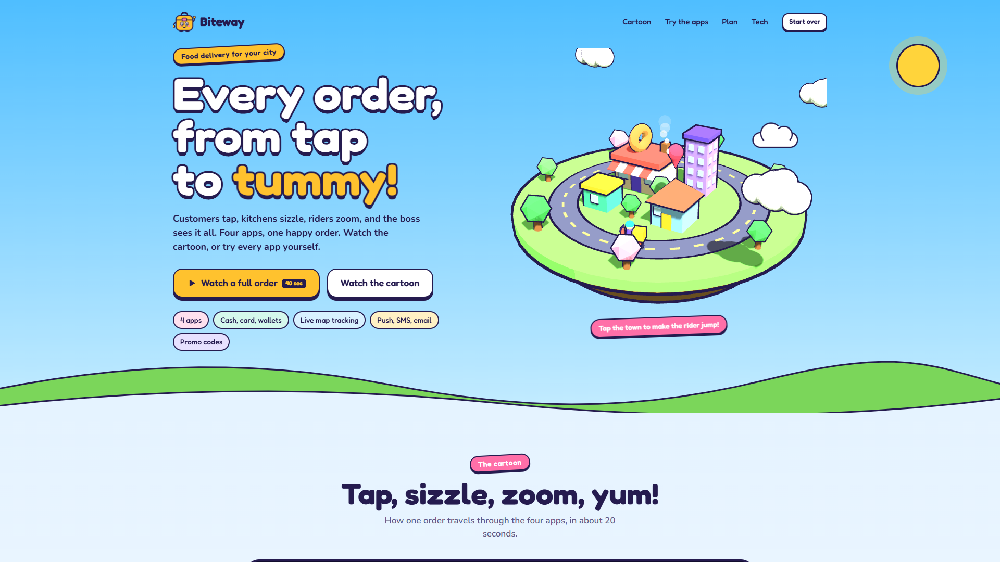

# Biteway

Biteway is a front-end prototype of a food delivery platform. Four apps share one live order: a customer app, a restaurant panel, a rider app and an admin console. You can place an order in one of them and watch the other three react.

It is a static site. There is no backend and no build step. The order state lives in memory in the browser, and all restaurants, people and numbers are sample data. "Biteway" is a placeholder name.



## What it covers

**Customer app** (phone frame)

- Restaurant list with search and category filters
- Menu, cart with quantity steppers, minimum order check
- Promo codes (`WELCOME50`, `FREEDEL`) and a bill breakdown
- Checkout by cash on delivery, card or mobile wallet
- Order tracking with a map, rider position and an ETA that counts down
- Rating after delivery, past orders, account settings and an SMS sign-up flow

**Restaurant panel**

- Order board with three columns: new, preparing, ready for pickup
- Accept or reject, with a prep time choice
- Menu availability switches that take effect in the customer app straight away
- Open or closed switch and a weekly payout summary

**Rider app** (phone frame)

- Online and offline status, earnings for the day
- Delivery request card with distance, pay and cash to collect
- Turn-by-turn instruction line and a moving map
- Pickup and delivery confirmation, including the cash collected step

**Admin console**

- KPI tiles, orders by hour chart, payment mix
- All orders, restaurant approvals, rider document approvals
- Promo code list with a form to create new codes
- Role and permission matrix

**Around the apps**

- "Watch a full order" plays one order through all four apps in about 40 seconds
- A guide line that says what to do next and in which app
- A side rail that lists every push, SMS, email and system event as it happens
- Build plan and tech stack sections describing how a production version could be built
- Light and dark colours follow the system setting, and the layout works on phones

## Screenshots

| Checkout | Restaurant panel |
| --- | --- |
|  |  |

| Live tracking | Admin console |
| --- | --- |
|  |  |

### Cartoon variant

`cartoon/` is the same four apps with a different skin: a toy town drawn with Three.js in the header, a short four-scene SVG cartoon that explains the order flow, and food illustrations with faces.



## Running it

Open `index.html` in a browser. For the cartoon variant open `cartoon/index.html`.

If you prefer a local server:

```
python -m http.server 8000
```

Then go to `http://localhost:8000/` or `http://localhost:8000/cartoon/`.

Fonts and Three.js are loaded from CDNs, so the first load needs a network connection. Without it the pages still work with fallback fonts, and the toy town is replaced by a flat drawing.

Each app has its own URL hash, which is handy for jumping straight to one: `#customer`, `#restaurant`, `#rider`, `#admin`.

## Files

```
index.html            main page markup
css/styles.css        layout, components, light and dark tokens
js/app.js             sample data, state, the four apps, autoplay
cartoon/index.html    cartoon variant markup
cartoon/css/cartoon.css   cartoon skin, loaded on top of css/styles.css
cartoon/js/app.js     same app logic plus the film player and the 3D scene
docs/screenshots/     images used in this README
```

The cartoon page reuses `css/styles.css` and overrides it with `cartoon.css`. The two `app.js` files are separate on purpose, since the cartoon one has its own artwork and extra sections.

## How it works

Everything renders from one state object in `js/app.js`. A click runs an action that changes the state, then the visible app, the status cards, the side rail and the guide are rendered again from it. The rider moves along two fixed routes on an SVG map, driven by `requestAnimationFrame`. Food pictures and icons are inline SVG, so there are no image files to load.

## Credits

- [Three.js](https://threejs.org/) r128, MIT licence, used for the toy town in the cartoon variant (loaded from cdnjs)
- Fonts from [Google Fonts](https://fonts.google.com/): Bricolage Grotesque, Figtree and JetBrains Mono on the main page, Fredoka and Nunito on the cartoon page
